# Stronkie's Olympics

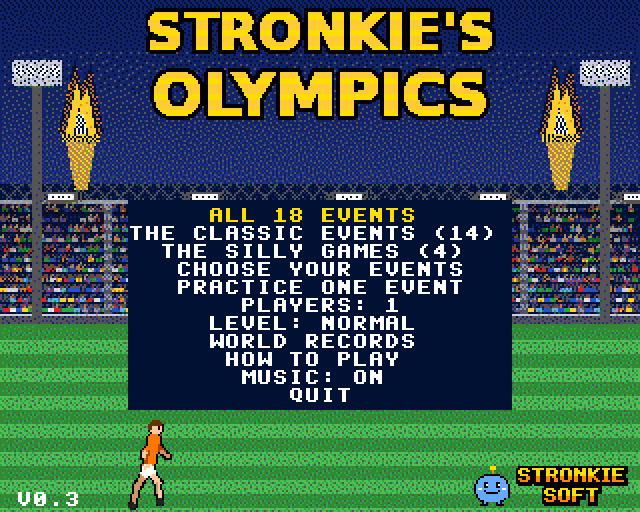

**The sports game for the Amiga 500.** Make your own athlete and go for gold in 18 events - from the 100m sprint to penguin curling - each one loaded from disk when it starts - with an opening ceremony where the flame is lit and a closing ceremony at night.

Created By Mark Stronks, Stronkie Soft © 2026

Written in 68000 assembly for a stock Amiga 500 with Kickstart / Workbench 1.3 and a 512K trapdoor expansion (1 MB). Runs from 3 bootable disks (or a Gotek), from hard drive / CF card and with WHDLoad. Play it with a joystick in port 2 (or the cursor keys and RETURN).

**Version: V0.3 - TEST VERSION.** On itch.io: https://stronkie.itch.io/ (with a free demo).

## The events

| Event | What you do |
|---|---|
| **Soccer** | A penalty shoot-out against another country: aim, set the power (not over the bar!), then dive as the keeper. 5 each, then sudden death |
| **Basketball** | The three point shoot-out: 5 racks of 5 balls in 60 seconds. Hold fire, let go in the green zone; the money ball counts 2 |
| **Volleyball** | Beach volleyball, 1 against 1, the first to 7. Run, jump, hit - and spike when you hit it high in a jump |
| **Bowling** | Ten pin bowling, 10 frames, real scoring with strikes and spares. Where you stand, the spin, the power |
| **Surfing** | Ride the wave for 60 seconds: cutbacks, airs off the lip and spins, points for riding close to the curl. 3 wipe-outs and out |
| **Skateboarding** | The half pipe: pump at the bottom, fly over the lip, turn around in the air, grab and spin. 3 falls and out |
| **100m Sprint** | Against a runner from another country: wait for GO, then left, right, left, right - the faster you waggle, the faster you run |
| **Hurdles** | 110 metres with 10 hurdles: fire to jump just before each one, hit one and you lose speed |
| **Long Jump** | Run, fire at the white board, hold fire for the angle. Three jumps, over the board is a foul |
| **Javelin** | Run, throw at the line, hold for the angle - then watch it fly over the field. Three throws |
| **Archery** | Six arrows: hold the swaying sight on the gold, mind the wind |
| **Swimming** | 50m freestyle: dive in at GO, swim, and press fire to breathe before your air runs out |
| **Weightlifting** | Clean and jerk: waggle the power over the line and fire - twice. 30 kg more after a good lift |
| **Cycling** | 500m on the velodrome with 5 gears: low gears pick up speed, high gears go faster |
| **Root Beer Sprint** *(silly)* | Drink your mug (hold fire, not too fast or you get the hiccups), burp, then run |
| **Pie Dodge** *(silly)* | Cross the arena as often as you can in 60 seconds while the clowns throw pies at you |
| **Penguin Curling** *(silly)* | Slide six penguins to the house: aim, power - and sweep! |
| **Toilet Paper Throw** *(silly)* | The javelin with a toilet roll that leaves a paper trail. Mind the wind |

## Features

- **Make your own athlete**: a name, your country (20 countries - your kit gets its colours), man or woman, skin and hair
- **1 to 4 players** take turns; in every event you meet 3 athletes from other countries (easy, normal or hard)
- **Gold, silver and bronze** for the best three, a **medal ceremony** on the podium with the **national anthem** of the winner, a **medal table** and a champion at the end
- **World records** saved on disk (with the holder's name and flag)
- **Every event is a separate file** (`Soccer.evt`, `Basket.evt` ...), loaded from disk when it starts: the game asks for the disk it needs
- **Opening ceremony** (`Ceremony.evt`): the athletes march into the stadium with their flags, your athlete carries the torch up the stairs, the flame is lit and the doves fly away, to the anthem
- **Closing ceremony** when all events are done: the stadium at night, fireworks, the athletes walk out and the flame goes out
- Voices ("Goal!", "Saved!", "Strike!", "Gold medal", "New world record" ...), a cheering crowd and sound effects
- **Music** written for this game in the style of a stadium anthem and a sports fanfare (no music by others), played quietly so the effects and voices can be heard. M switches it off
- Practice mode; compete in all 18 events, the 14 classic ones, the 4 silly ones, or choose

## Screenshots

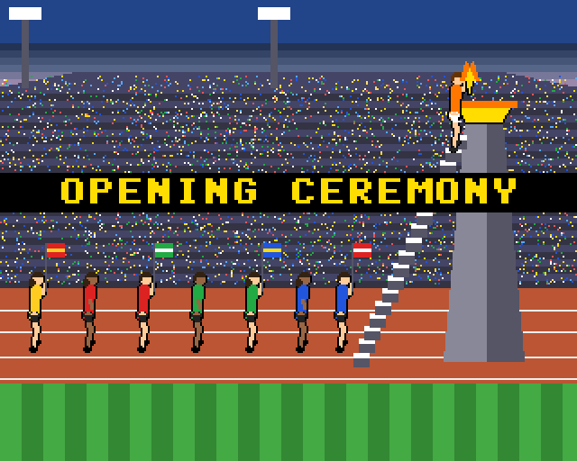
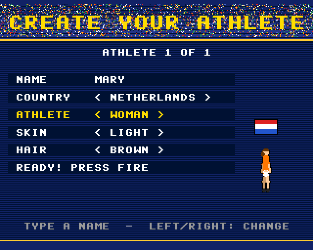
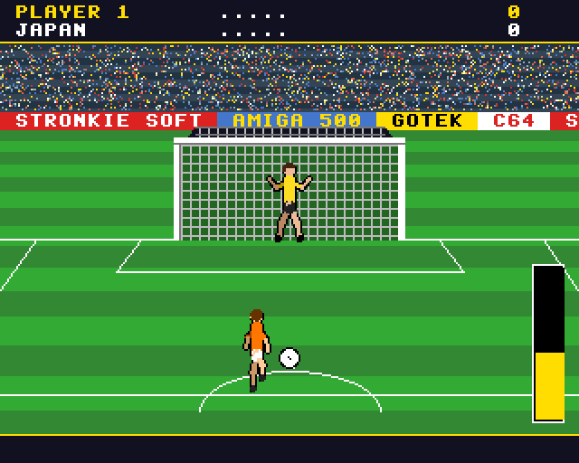
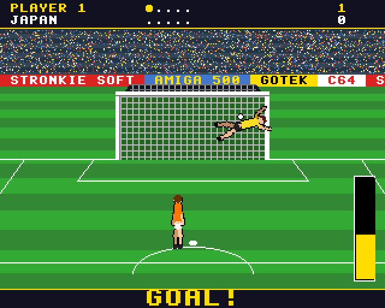
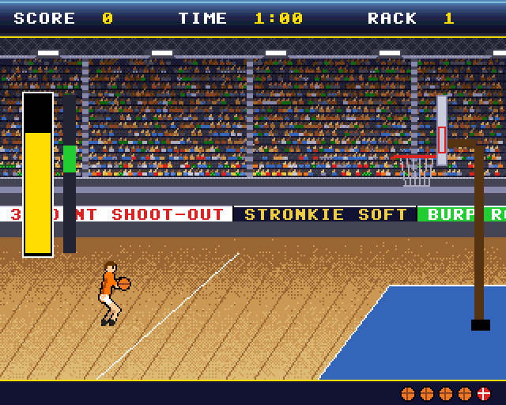
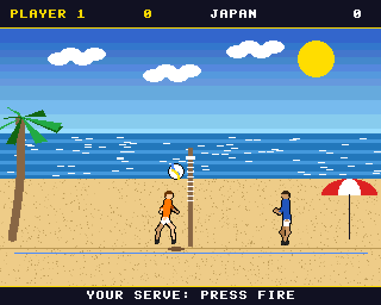
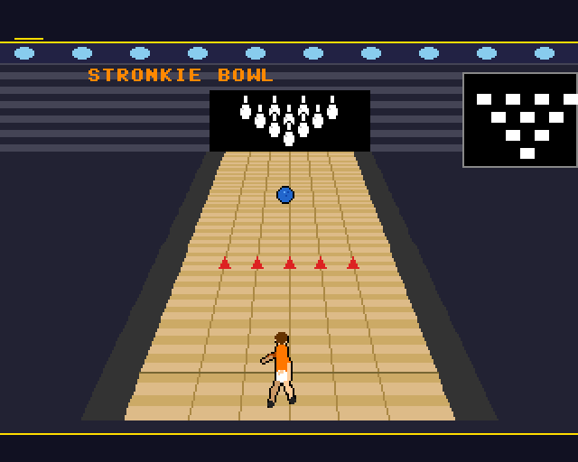
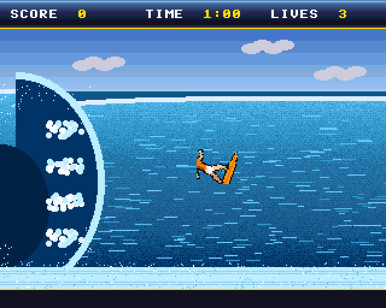
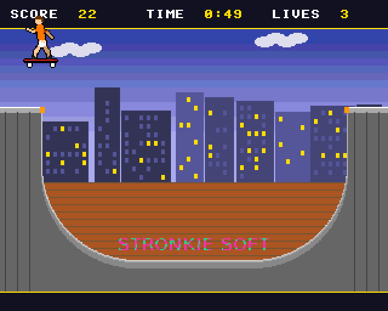
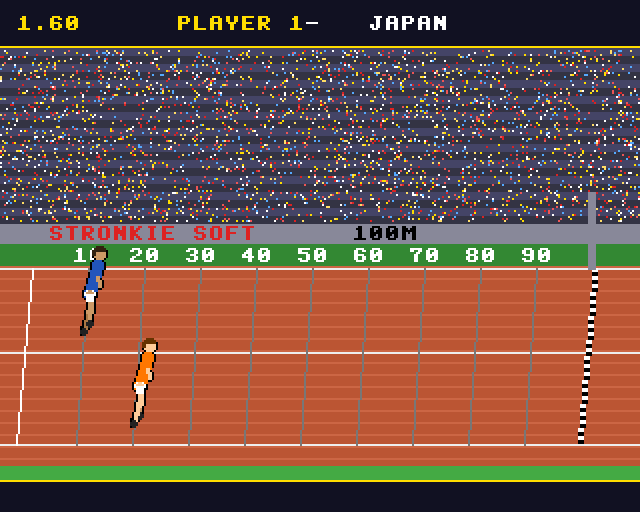
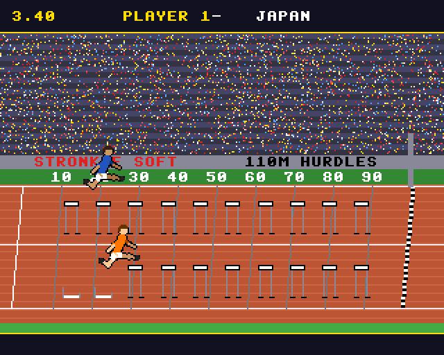
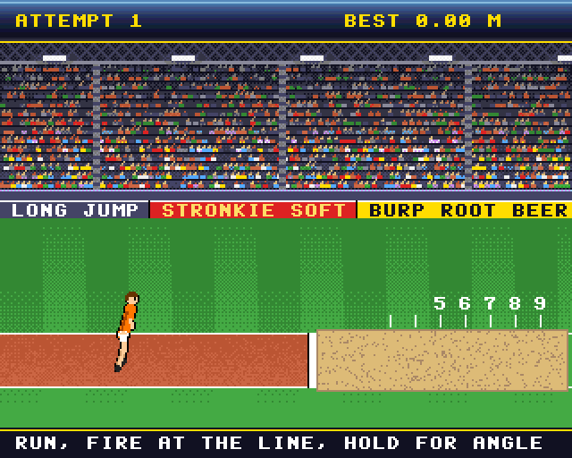
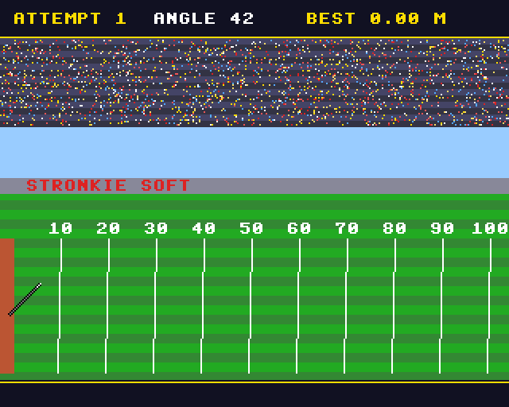
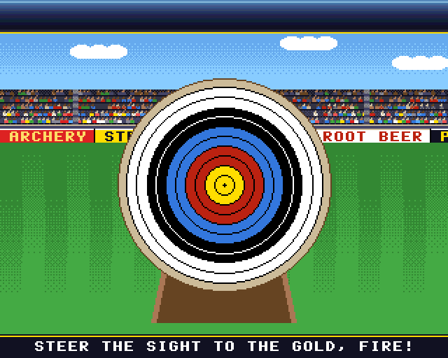
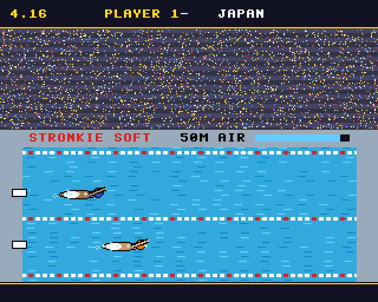
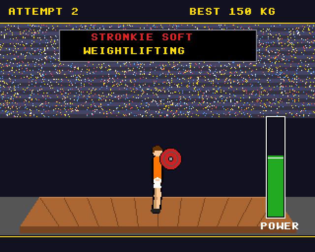
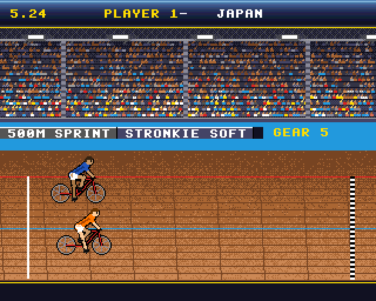
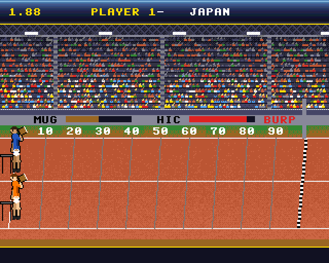
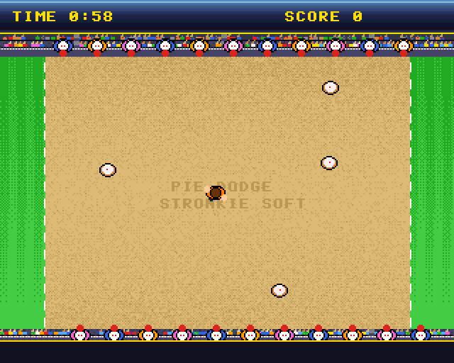
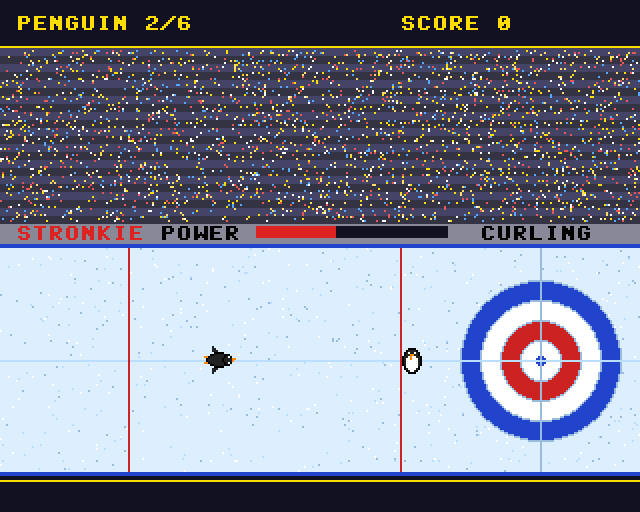
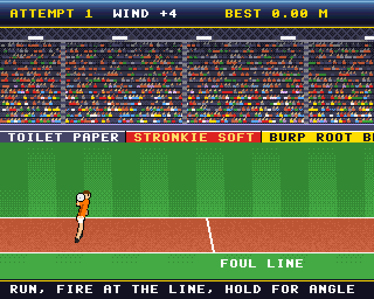
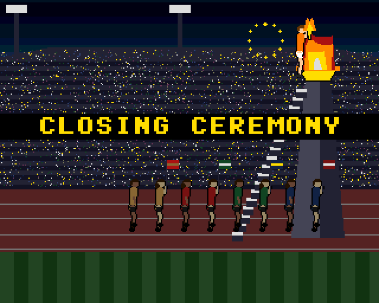

## Download and run

| File | What it is |
|---|---|
| `StronkiesOlympics_V0.3_Disk1.adf` + `_Disk2.adf` + `_Disk3.adf` | The full game on 3 disks. Boot disk 1 (or put them on a Gotek); the game asks for the disk it needs |
| `StronkiesOlympics_V0.3_harddrive.zip` | Drawer `StronkiesOlympics` with everything: copy it to your hard drive / CF card and double click `SOlymp` |
| `whdload/StronkiesOlympics_V0.3_WHDLoad.lha` | **WHDLoad version** (also as `.zip`): own slave (`src/whdload.s`), no Kickstart image needed, F10 quits |
| `demo/` | The free demo: the opening ceremony and Soccer (1 disk, hard drive and WHDLoad) |

**Requirements:** Amiga 500 (or any Amiga with a 68000) with Kickstart 1.3 and 1 MB: 512K chip + 512K trapdoor.

## Building

`sh tools/build.sh` (Python 3 with Pillow and numpy). Everything is made by the tools in `tools/`: the 68000 assembler (`asm68k.py`), the graphics, sounds, voices and music (`make_main.py`, `ev_*.py`), the disks (`make_disk.py`) and WHDLoad (`make_whdload.py`). `tools/emu68k.py` is a small Amiga 500 test bench used for the tests and the screenshots (`tools/shots.py`, `tools/test_whdload.py`).

Source: `src/kernel.s` + `src/main.s` (the main program: display, bobs, sound, input, loading the events, menus, medals), `src/ev_*.s` (one file per event and the ceremonies, see `src/kernel.i` for how they talk to the main program), `src/loader.s`, `src/whdload.s`.

Created By Mark Stronks, Stronkie Soft
